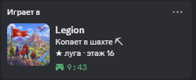

# Легион → Discord

Статус **«Играет в Legion»** в Discord для игры **Легион** на [play.multidonate.ru](https://play.multidonate.ru/c/zakvielchannel/).

Пока у тебя открыт сайт игры, в профиле Discord видно:

- где ты: *Копает в шахте ⛏*, *В походе*, *Гуляет по Городу*, *Прокачивает героя* и т.д.;
- смайлик и название твоего класса и этаж шахты: *🛡️ Легионер · ★ луга · этаж 16*;
- сколько времени ты играешь;
- кнопка «Открыть Легион» для тех, кто смотрит твой профиль.

Закрыл сайт — статус через пару минут пропадает сам. **Скрипт ничего не нажимает в игре** — он только читает, какой раздел открыт.

| Класс | Смайлик | Класс | Смайлик |
|---|---|---|---|
| Новобранец | 🔰 | Жрец | ✨ |
| Легионер | 🛡️ | Разбойник | 🗡️ |
| Лучник | 🏹 | Некромант | 💀 |
| Маг | 🔮 | Паладин | ⚜️ |

> Работает только с **приложением Discord на компьютере** (Windows / macOS / Linux). Discord в браузере и на телефоне такой статус показывать не умеет.

## Из чего состоит

| Файл | Что это |
|---|---|
| `legion_discord.py` | Программа на компьютере: держит связь с Discord и ставит статус |
| `legion-discord.user.js` | Скрипт для Tampermonkey: раз в 15 секунд сообщает программе, где ты на сайте |
| `start-legion-discord.bat` | Запуск для Windows двойным щелчком |
| `assets/legion.png` | Картинка для статуса (автор — 3odaPl) |
| `assets/icon-emblem.png` | Запасная иконка-эмблема |

## Установка

### 1. Python

Скачай Python с [python.org](https://www.python.org/downloads/). При установке поставь галочку **Add python.exe to PATH**.

### 2. Программа

Скачай репозиторий: зелёная кнопка **Code → Download ZIP**, распакуй в любую папку. Больше ничего настраивать не нужно — приложение «Legion» в Discord уже общее, с готовой картинкой.

### 3. Скрипт в браузере

1. Установи расширение [Tampermonkey](https://www.tampermonkey.net/) (Chrome, Edge, Firefox).
2. Открой файл [`legion-discord.user.js`](legion-discord.user.js) → кнопка **Raw** → Tampermonkey предложит установить.
3. Когда Tampermonkey спросит про доступ к `127.0.0.1` — нажми **«Всегда разрешать»** (это твой же компьютер, туда скрипт отправляет статус).

### 4. Discord

**Настройки → Конфиденциальность активности** → включи показ активности.

Хочу своё название или картинку

1. Открой [discord.com/developers/applications](https://discord.com/developers/applications) → **Создать новое приложение** и назови как хочешь — это имя будет после «Играет в».
2. На вкладке **General Information** скопируй **Application ID**.
3. **Rich Presence → Art Assets** → загрузи картинку с именем **`legion`** (можно взять из папки `assets`).
4. Открой `legion_discord.py` Блокнотом и замени число в строке `CLIENT_ID = "…"` на свой ID.

## Запуск

1. Запусти Discord на компьютере.
2. Двойной щелчок по `start-legion-discord.bat` (на macOS/Linux: `pip install pypresence`, затем `python3 legion_discord.py`). Окно не закрывай.
3. Открой игру — через несколько секунд в Discord появится статус.

Хочешь статус без скрипта в браузере — запусти `python legion_discord.py --always`: «Играет в Legion» будет висеть, пока программа открыта.

## Настройки

В начале `legion_discord.py`:

| Настройка | Что делает |
|---|---|
| `CLIENT_ID` | Application ID приложения в Discord (по умолчанию — общее «Legion») |
| `LARGE_IMAGE` | Имя картинки из Art Assets |
| `GAME_URL` | Ссылка для кнопки «Открыть Легион» (поставь свой канал) |
| `SHOW_BUTTON` | `False` — без кнопки |
| `PORT` | Порт связи со скриптом (если меняешь — поменяй и в `legion-discord.user.js`) |

## Если не работает

- **«Нет связи с Discord»** — Discord на компьютере не запущен или запущен от администратора, а программа нет (или наоборот).
- **Статус не появляется** — проверь, что в Tampermonkey скрипт включён и доступ к `127.0.0.1` разрешён; что в окне программы есть строка «Статус: …».
- **Нет картинки** — имя ассета должно совпадать с `LARGE_IMAGE`; после загрузки Discord иногда показывает её через несколько минут.

---

Неофициальный фан-проект, не связан с авторами игры и с Discord.
